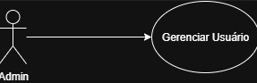
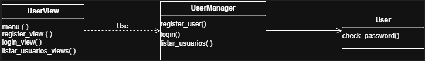
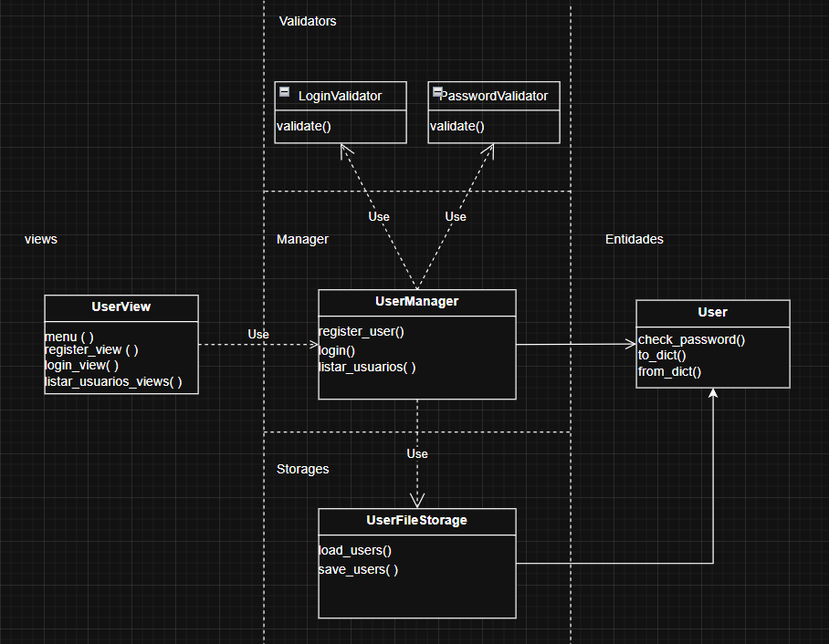
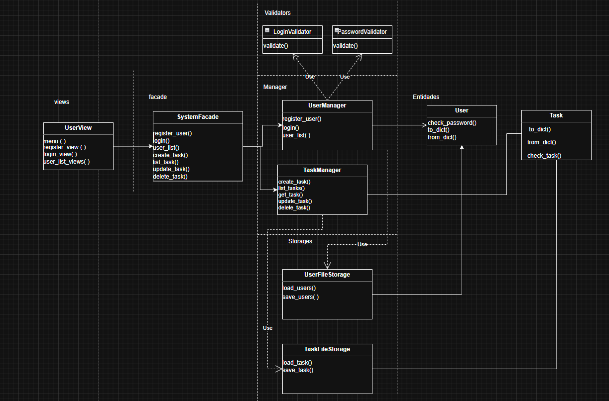
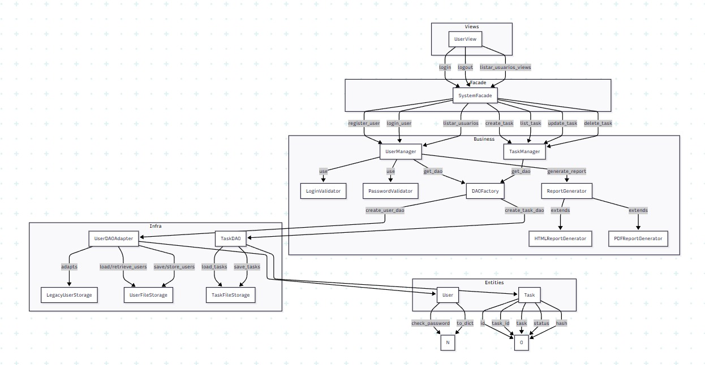

# metodos-UFPB
 Trabalho de Metodos de Projeto de Software

 Neste trabalho, implementaremos um sistema de apoio a idosos com Alzheimer, como forma de tardamento das perdas cognitivas dos usuários.

 A aplicação visa, com o acompanhamento da Inteligência Artificial, criar um caminho de jogos para os níveis de perdas cognitivas diversas. Tal que, o usuário receba um jogo de próxima fase, com base no seu desempenho na anterior, tendo em vista tardar a perca da memória.

 Para o desenvolvimento do projeto, a equipe escolhe o Desenvolvimento Web com a linguagem Python com a biblioteca Streamlit para interface gráfica.

 Documentação de requisitos do projeto: - https://docs.google.com/document/d/1GsUDEq24Sa9pXWozzbTYL8AJC163UCiJ7rDML9g-Ygs/edit?usp=sharing - 
 Sprints:

 Sprint 1 - Desenvolvimento do Diagrama de Classes e Implementação inicial do caso de uso de gerenciar usuário.

 -Imagem 1 - Diagrama UML -

 

 -Imagem 2 - Diagrama de Classes - 

 

 Sprint 2 - Atualização do Diagrama de Classes - Implementação de validação para login e senha e persistência de dados com arquivo JSON.

-Imagem 3 - Diagrama de Classes -



Sprint 3 - Atualização do Diagrama de Classe - Implementação da camada de Task.

-Imagem 4 - Diagrama de Classes -



Sprint 4 - Diagrama de Classes - Separação das camadas de business e persistência, implementando o uso de Factory Method. Além do uso do padrão Adapter para o cenário de "adaptar" a interface do LegacyUserStorage para a interface DAO . Na camada business foi implementado com Template Method a geração de relotório em HTML e PDF, gerando estatísticas de acesso ao sistema pelo usuário

-Imagem 5 - Diagrama de Classes -



Sprint Final - Diagrama de Classes C4- Padrões de Projeto
- Factory Method:Criar famílias de objetos relacionados sem especificar suas classes concretas
Classes Envolvidas:
- UserFileStorage
- AtividadeFileStorage

- Template Method: Definir o esqueleto de um algoritmo, delegando alguns passos para subclasses

Classes Envolvidas:
- UserManager → UserFileStorage
- AtividadeManager → AtividadeFileStorage
- ReportGenerator → HTMLReportGenerator PDFReportGenerator

- Adapter: Converter a interface de uma classe em outra interface esperada pelos clientes

Classes Envolvidas:
- UserStorageAdapter
- LegacyUserStorage
- UserFileStorage

- Strategy: Definir uma família de algoritmos, encapsular cada um e torná-los intercambiáveis

Classes Envolvidas:
- LoginValidator
- PasswordValidator

- MVC: Separar a aplicação em três componentes principais: Model, View e Controller

Classes Envolvidas:
- Model: User, Atividade, UserManager, AtividadeManager
- View: UserView, AtividadeView, QuestionnaireView
- Controller: gerenciamento_app, login_app

========== LEGENDA DE CORES ==========
 🟦 Azul  → dependência / associação (usa, possui)
 🟨 Amarelo → estratégia / comportamento injetável
 🟩 Verde  → template method (relatórios)
 🟪 Roxo   → view (camada de apresentação)
 🟥 Vermelho → adapter / legado (camada de integração)

## Diagrama Final  

``` mermaid 
classDiagram

%% ========== LEGENDA DE CORES ==========
%% 🟦 Azul  → dependência / associação (usa, possui)
%% 🟨 Amarelo → estratégia / comportamento injetável
%% 🟩 Verde  → template method (relatórios)
%% 🟪 Roxo   → view (camada de apresentação)
%% 🟥 Vermelho → adapter / legado (camada de integração)

%% ========== ENTIDADES ==========
class User {
  <<Entity>>
  +String username
  +String password
  +Dict gabarito
  +check_password(password: String) Boolean
  +to_dict() Dict
  +from_dict(data: Dict) User
}

class Atividade {
  <<Entity>>
  +String id
  +String nome
  +String descricao
  +String dificuldade
  +String tipo
  +List opcoes
  +String categoria
  +String resposta
  +to_dict() Dict
  +from_dict(data: Dict) Atividade
}

%% ========== DOMAIN ==========
class Question {
  <<Abstract>>
  +String id
  +String enunciado
  +String dificuldade
  +avaliar(resposta_usuario: String) Boolean
}
class ObjectiveQuestion {
  +String resposta_correta
  +List~String~ opcoes
  +avaliar(resposta_usuario: String) Boolean
}
class PersonalQuestion {
  +avaliar(resposta_usuario: String, gabarito_usuario: String) Boolean
}
class Answer {
  +String question_id
  +String value
}
class Questionnaire {
  +List~Question~ questions
  +avaliar(respostas: Dict, gabaritos_pessoais: Dict) Dict
}

ObjectiveQuestion --|> Question
PersonalQuestion --|> Question
Questionnaire ..> Question : aggregates

%% ========== SERVICES ==========
class QuestionnaireService {
  +carregar_questionario() Questionnaire
  +avaliar_para_usuario(username: String, respostas: Dict) Dict
}
QuestionnaireService --> Questionnaire : returns

%% ========== REPOSITORIES (Interfaces de Domínio) ==========
class IUserRepository {
  <<Interface>>
  +obter_por_username(username: String) Any
  +salvar_gabaritos(username: String, gabaritos: Dict~String,String~) void
}
class IAtividadeRepository {
  <<Interface>>
  +listar() Iterable~Any~
}

class UserRepository {
  +obter_por_username(username: String) Any
  +salvar_gabaritos(username: String, gabaritos: Dict~String,String~) void
}
class AtividadeRepository {
  +listar() Iterable~Any~
}

UserRepository ..|> IUserRepository
AtividadeRepository ..|> IAtividadeRepository
QuestionnaireService --> IUserRepository : uses
QuestionnaireService --> IAtividadeRepository : uses

%% ========== MANAGERS ==========
class UserManager {
  <<Business Logic>>
  🟦UserFileStorage storage
  +List~User~ users
  +register_user(username: String, password: String) void
  +login(username: String, password: String) Boolean
  +listar_usuarios() List~User~
  +get_user(username: String) User
  +save_users() void
  +update_gabarito(username: String, gabarito: Dict) void
}

class AtividadeManager {
  <<Business Logic>>
  🟦List~Atividade~ atividades
  +listar() List~Atividade~
  +buscar_por_id(id: String) Atividade
  +criar(...) Atividade
  +atualizar(id: String, ...) Atividade
  +deletar(id: String) Boolean
}

UserRepository --> UserManager : 🟦 uses
AtividadeRepository --> AtividadeManager : 🟦 uses

%% ========== STORAGE ==========
class UserFileStorage {
  <<Storage>>
  🟦+String file_path
  🟦+load_users() List~User~
  🟦+save_users(users: List~User~) void
}
class AtividadeFileStorage {
  <<Storage>>
  🟦+String FILE_PATH
  🟦+load() List~Atividade~
  🟦+save(atividades: List~Atividade~) void
}

UserManager --> UserFileStorage : 🟦 uses
AtividadeManager --> AtividadeFileStorage : 🟦 uses
UserFileStorage --> User : persists
AtividadeFileStorage --> Atividade : persists

%% ========== VALIDATORS ==========
class LoginValidator {
  <<Strategy>>
  🟨+validate(username: String) void
}
class PasswordValidator {
  <<Strategy>>
  🟨+validate(password: String) void
}

UserManager --> LoginValidator : 🟨 validates
UserManager --> PasswordValidator : 🟨 validates

%% ========== REPORTING (BUSINESS) ==========
class ReportGenerator {
  <<Abstract>>
  🟩+generate_report(data: Dict) String
  🟩#_format_header() String
  🟩#_format_body(data: Dict) String
  🟩#_format_footer() String
}
class HTMLReportGenerator {
  <<Concrete>>
  🟩#_format_header() String
  🟩#_format_body(data: Dict) String
  🟩#_format_footer() String
}
class PDFReportGenerator {
  <<Concrete>>
  🟩#_format_header() String
  🟩#_format_body(data: Dict) String
  🟩#_format_footer() String
}

HTMLReportGenerator --|> ReportGenerator
PDFReportGenerator --|> ReportGenerator

class RelatorioView {
  <<View>>
  🟪+render(data: Dict) void
}
class ReportView {
  <<View>>
  🟪+render_html(data: Dict) void
  🟪+render_pdf(data: Dict) void
}

RelatorioView --> ReportGenerator : 🟩 uses
ReportView --> HTMLReportGenerator : 🟩 uses
ReportView --> PDFReportGenerator : 🟩 uses

%% ========== VIEWS (CRUD/QUESTIONÁRIO) ==========
class UserView {
  <<View>>
  🟪UserManager manager
  🟪+menu_streamlit() void
}
class AtividadeView {
  <<View>>
  🟪AtividadeManager manager
  🟪+menu_streamlit() void
}
class QuestionnaireView {
  <<View>>
  🟪UserManager manager
  🟪AtividadeManager atividade_manager
  🟪+menu_streamlit() void
}

UserView --> UserManager : 🟪 controls
AtividadeView --> AtividadeManager : 🟪 controls
QuestionnaireView --> UserManager : 🟪 uses
QuestionnaireView --> AtividadeManager : 🟪 uses

%% ========== CONTROLLERS ==========
class main_py {
  <<Controller>>
  +main()
}
main_py --> UserView : 🟪 coordinates
main_py --> AtividadeView : 🟪 coordinates
main_py --> QuestionnaireView : 🟪 coordinates

%% ========== (OPCIONAL) LEGACY/ADAPTER ==========
class LegacyUserStorage {
  <<Legacy>>
  🟥+load_legacy_users() List
}
class UserStorageAdapter {
  <<Adapter>>
  🟥LegacyUserStorage legacy_storage
  🟥+load_users() List~User~
}

class LegacyUserRepositoryAdapter {
  🟥+obter_por_username(username: String) Any
  🟥+salvar_gabaritos(username: String, gabaritos: Dict) void
}
LegacyUserRepositoryAdapter ..|> IUserRepository
LegacyUserRepositoryAdapter --> UserStorageAdapter : 🟥 uses
UserStorageAdapter --> LegacyUserStorage : 🟥 adapts


```


## Questionário e Atividades (uso rápido)

Este repositório tem um CRUD de atividades e uma tela de questionário que usa as atividades como perguntas.

Cada atividade agora possui os campos adicionais:
- `tipo`: `text` ou `multiple` (texto livre ou múltipla escolha)
- `opcoes`: lista de opções (apenas para `multiple`)
- `categoria`: `pessoal` ou `objetiva` (define se a pergunta é pessoal do usuário ou uma pergunta objetiva com resposta conhecida)
- `resposta`: resposta correta (apenas para `objetiva`)

Comportamento importante:
- Ao criar uma atividade com `categoria = objetiva` você deve informar a `resposta` imediatamente. Para `tipo = text`, a resposta é armazenada em minúsculas. Para `multiple` pode-se informar a letra (ex: `a`) ou o texto da opção (será normalizado em minúsculas).
- Perguntas `pessoal` têm suas respostas salvas no gabarito do usuário na primeira vez que ele faz o questionário. Nas próximas execuções, as respostas pessoais são comparadas com esse gabarito salvo.
- Perguntas `objetiva` usam a `resposta` armazenada na própria atividade para comparar (não são salvas no gabarito do usuário).

Exemplos (via interface de Atividade):

- Criar pergunta objetiva (texto):
	- ID: `q_brasil`
	- Nome: `Descobrimento do Brasil`
	- Descrição: `Em que ano ocorreu o descobrimento do Brasil?`
	- Tipo: `text`
	- Categoria: `objetiva`
	- Resposta correta: `1500`  (será armazenada em minúsculas)

- Criar pergunta objetiva (múltipla escolha):
	- ID: `q_capital`
	- Nome: `Capital do Brasil`
	- Descrição: `Qual é a capital do Brasil?`
	- Tipo: `multiple`
	- Opções: `a) Brasília; b) Rio; c) São Paulo`
	- Categoria: `objetiva`
	- Resposta correta: `a`  (ou `a) Brasília`)

- Criar pergunta pessoal:
	- ID: `q_nome`
	- Nome: `Nome completo`
	- Descrição: `Qual seu nome completo?`
	- Tipo: `text`
	- Categoria: `pessoal`

Fluxo do questionário:
- Execute o app (ou rode `streamlit run gerenciamento.py`) e escolha o menu de Atividades para criar as atividades acima.
- Faça o cadastro/login de um usuário (se necessário).
- No menu do Questionário, escolha `Fazer questionário` e informe o username.

Comportamento esperado:
- Para a pergunta objetiva `q_brasil`: o sistema compara a resposta do usuário (convertida para minúsculas) com `1500` e informa se está correta.
- Para a pergunta objetiva `q_capital`: o usuário pode digitar `a` ou `a) Brasília` ou `brasília`; o sistema normaliza e compara com a resposta armazenada.
- Para a pergunta pessoal `q_nome`: na primeira execução a resposta será salva no gabarito do usuário; nas próximas vezes será comparada com o gabarito salvo.

Comandos rápidos (PowerShell):
```powershell
python3 -m venv venv (Criação de ambiente virtual)
```
```powershell
pip install -r requirements.txt (Instalação das bibliotecas dentro do ambiente virtual)
```
```powershell
streamlit run gerenciamento_app.py
```
